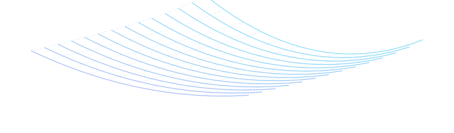
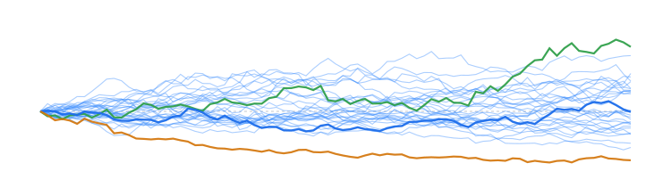

<div align="center">

<!-- Adaptive Logo: switches automatically between dark and light theme -->
<picture>
  <source media="(prefers-color-scheme: dark)" srcset="logo-white.png">
  <source media="(prefers-color-scheme: light)" srcset="logo.png">
  
</picture>

# JJ (`@0xJJphy`)

### Math • Systems • Quantitative Finance

```text
"Finance nerd doing nerd things"
```

<p align="center">
  
  
  
</p>

<!-- 1 Row, 2 Columns: Mathematical Visuals -->
<table width="100%">
  <tr>
    <td width="50%" align="center">
      
    </td>
    <td width="50%" align="center">
      
    </td>
  </tr>
</table>

</div>

---

### ☕ What I Do

I like breaking down financial markets with math and building fast, reliable software around the data.

- **Math & Research:** Stochastic calculus, probability, time-series analysis, volatility modeling, and market microstructure.
- **Systems & Code:** Writing fast, deterministic tools in **C++**, **Rust**, **Python**, and **R**.
- **Data & Heavy SQL:** Wrangling multi-exchange order flow, market depth, and large historical time-series with **SQL** and **PostgreSQL**.
- **Visuals & Web:** Building interactive analytics and 3D data graphics using **Three.js**, **WebAssembly**, **Svelte**, and **React**.

---

### 🛠️ Technical Stack

- **Languages:** `C`, `C++`, `Rust`, `Python`, `R`, `SQL`, `TypeScript / JavaScript`
- **Math & Quant:** `Stochastic Calculus`, `Probability & Statistics`, `Linear Algebra`, `Time-Series Modeling`, `Microstructure & Order Flow`
- **Graphics & Web Systems:** `Three.js`, `WebAssembly (Wasm)`, `Svelte 5 / Vite`, `React`, `FastAPI`, `TradingView Lightweight Charts`
- **Databases & Tooling:** `PostgreSQL`, `Polars`, `Pandas`, `Parquet`, `Docker`, `Git`, `macOS / Linux`

---

### 🚀 Projects

<table>
  <tr>
    <td width="55%">
      <h3>📉 <a href="https://github.com/0xJJphy/BTC-Chart-Terminal-ST">BTC-Chart-Terminal-ST</a></h3>
      <p>Crypto analysis terminal built with Svelte & Vite. Detects liquidity sweeps and Smart Money Concepts (FVG & Order Blocks), with a causal Rust/Wasm backtest engine and historical replay.</p>
      <p>
        
        
        
      </p>
    </td>
    <td width="45%" align="center">
      <a href="https://github.com/0xJJphy/BTC-Chart-Terminal-ST">
        
      </a>
    </td>
  </tr>
  <tr>
    <td colspan="2">
      <h3>📈 GLI-CLI-Estimation <em>(Proprietary / Core Research)</em></h3>
      <p>Global Liquidity Index (GLI) & Central Liquidity Index (CLI) regime detection dashboard. FastAPI backend, Rust backtesting kernel, PostgreSQL database, and a real-time reactive Svelte 5 frontend.</p>
      <p>
        
        
        
        
      </p>
    </td>
  </tr>
  <tr>
    <td width="50%">
      <h3>📊 <a href="https://github.com/0xJJphy/MMT_INDICATORS">MMT_INDICATORS</a></h3>
      <p>Custom quantitative indicators in M5 scripting v3. Cross-basket correlation & dispersion engines, beta sensitivities, multi-anchor VWAP suites with volatility bands, and order-flow telemetry.</p>
      <p>
        
        
        
      </p>
    </td>
    <td width="50%">
      <h3>⛏️ <a href="https://github.com/0xJJphy/BTC-SPOT-WEIGHTED">BTC-SPOT-WEIGHTED</a></h3>
      <p>Multi-exchange spot pipeline pulling 1D OHLCV data across 9 exchanges. Computes volume-weighted aggregated candles, outlier filtering, Kimchi/Coinbase premiums, and stores normalized data in PostgreSQL.</p>
      <p>
        
        
        
      </p>
    </td>
  </tr>
</table>

---

### 📊 GitHub Activity

<div align="center">

  <picture>
    <source media="(prefers-color-scheme: dark)" srcset="https://github-readme-stats.vercel.app/api?username=0xJJphy&show_icons=true&theme=tokyonight&hide_border=true&bg_color=00000000&title_color=58a6ff&icon_color=79c0ff&text_color=c9d1d9">
    <source media="(prefers-color-scheme: light)" srcset="https://github-readme-stats.vercel.app/api?username=0xJJphy&show_icons=true&theme=default&hide_border=true&bg_color=00000000&title_color=0969da&icon_color=0969da&text_color=24292f">
    
  </picture>

  <picture>
    <source media="(prefers-color-scheme: dark)" srcset="https://github-readme-stats.vercel.app/api/top-langs/?username=0xJJphy&layout=compact&theme=tokyonight&hide_border=true&bg_color=00000000&title_color=58a6ff&text_color=c9d1d9">
    <source media="(prefers-color-scheme: light)" srcset="https://github-readme-stats.vercel.app/api/top-langs/?username=0xJJphy&layout=compact&theme=default&hide_border=true&bg_color=00000000&title_color=0969da&text_color=24292f">
    
  </picture>

</div>
